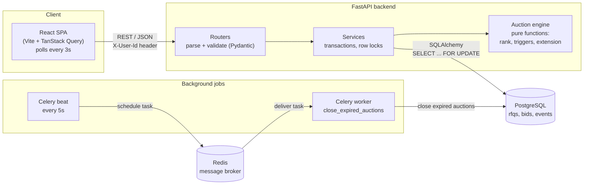
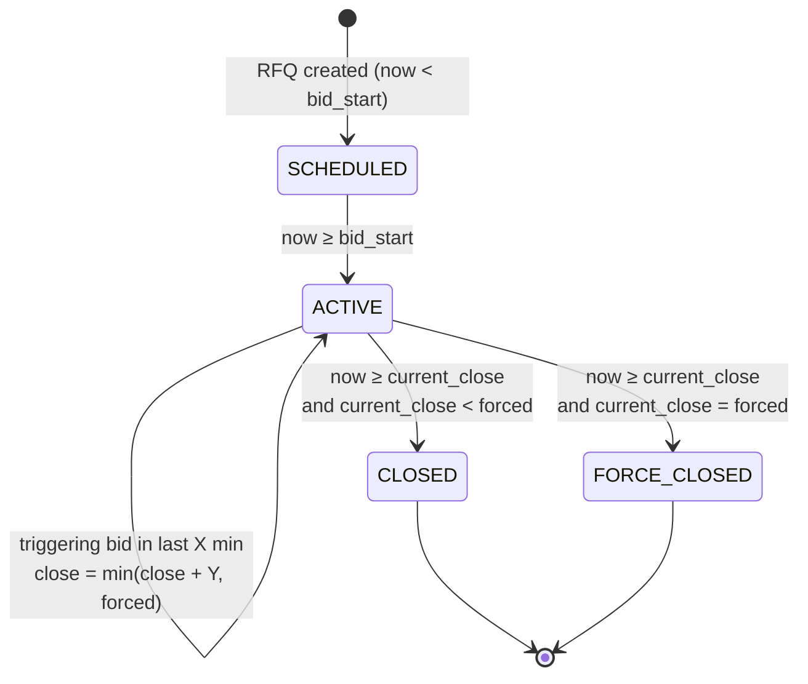
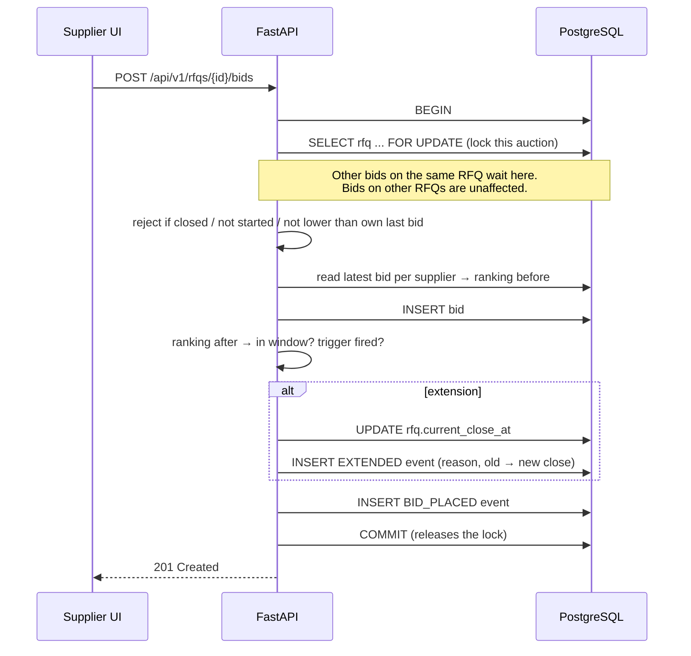

# High-Level Design

## 1. Overview

A simplified RFQ system where suppliers compete in a **British (reverse) auction**. Buyers create
RFQs with auction rules; suppliers submit decreasing bids; late activity extends the auction,
but never past a **forced close**.

## 2. Architecture



| Component | Responsibility | Technology |
|---|---|---|
| Frontend | Listing, create-RFQ form, details page (ranking, bids, config, activity log), bid form, countdown | React, Vite, TanStack Query, React Router |
| Routers | HTTP ↔ Python: parse input, validate, return JSON or a standard error | FastAPI, Pydantic |
| Services | Business flow in one DB transaction; per-auction row lock while bidding | SQLAlchemy 2.0 |
| Auction engine | Pure rules: ranking, tie-break, trigger window, trigger evaluation, extension cap, status | Plain Python (no I/O, so easy to unit-test) |
| Database | Source of truth; CHECK constraints guard the rules | PostgreSQL 16 + Alembic migrations |
| Broker | Carries scheduled task messages from beat to the worker | Redis 7 |
| Worker | Every 5 s marks auctions whose close time has passed as CLOSED / FORCE_CLOSED | Celery worker + beat |

## 3. Auction lifecycle



- Only `ACTIVE`, `CLOSED` and `FORCE_CLOSED` are stored. `SCHEDULED` is worked out from `bid_start_at`.
- The status shown to users is **computed from timestamps on every read**, so it's correct
  even if the worker hasn't run yet. The worker only persists the final status and writes the
  CLOSED event.

## 4. Extension rules

Configured per RFQ: trigger window **X** minutes, extension **Y** minutes, and one trigger type.

| Trigger | Fires when a bid inside the window... |
|---|---|
| `ANY_BID` | is received |
| `ANY_RANK_CHANGE` | changes the position of any supplier already ranked |
| `L1_CHANGE` | changes which supplier is lowest (L1) |

```
window      = [current_close − X, current_close)      start inclusive, end exclusive
new_close   = min(current_close + Y, forced_close)    never beyond the forced close
```

Example: close 18:00, X = 10, Y = 5, forced 18:30. A bid at 17:55 moves the close to 18:05.
The window is now 17:55–18:05, so further late bids keep extending it: 18:10, 18:15, ... up to
18:30.

## 5. Placing a bid (core flow)



**Why the row lock:** without it, two bids arriving at the same moment could both read close =
18:00 and both write 18:05, so one extension is lost. With `SELECT ... FOR UPDATE`, bids on the
same auction run one after another, and each sees the result of the previous one.

## 6. API

| Method | Path | Purpose | Responses |
|---|---|---|---|
| POST | `/api/v1/users` | create a demo buyer/supplier | 201, 422 |
| GET | `/api/v1/users` | list users (UI user switcher) | 200 |
| POST | `/api/v1/rfqs` | create an RFQ + auction config (buyer) | 201, 403, 409, 422 |
| GET | `/api/v1/rfqs` | listing: name/ID, lowest bid, current & forced close, status | 200 |
| GET | `/api/v1/rfqs/{id}` | details: config, ranking, all bids, metrics | 200, 404 |
| POST | `/api/v1/rfqs/{id}/bids` | submit a quote (supplier) | 201, 403, 409 closed / not started, 422 not lower |
| GET | `/api/v1/rfqs/{id}/events` | activity log, newest first | 200, 404 |
| GET | `/health` | DB connectivity check | 200 |

All errors use one shape: `{"error": {"code": "AUCTION_CLOSED", "message": "..."}}`.

## 7. Key design decisions

| Decision | Why | Alternative |
|---|---|---|
| Pessimistic row lock per RFQ | Simple, strongly consistent; locks one auction, not the table | Optimistic locking with a version column (needs retries) |
| Pure auction engine | Rules are unit-tested without a DB or server | Logic mixed into the request handler |
| Periodic sweep (Celery beat) + status computed on read | Correct even if the worker is down; no per-auction timers to reschedule on every extension | One delayed task per auction (must be cancelled and rescheduled on each extension) |
| Polling every 3 s | Simple and robust for a demo | WebSockets / SSE (live push, more moving parts) |
| Server is the only clock | Clients can't cheat by changing their clock; the UI countdown uses `server_time` | Trusting the browser time |
| Sync SQLAlchemy | Simpler transaction and locking code | Async SQLAlchemy |

## 8. Scaling notes

- **Many auctions:** locks are per RFQ row, so different auctions never block each other. The
  API is stateless and can run as several instances behind a load balancer. The data can be
  partitioned or sharded by `rfq_id`.
- **One very hot auction:** every bid on it is serialised by the lock. Options: cache the ranking
  in Redis, queue bids per auction through a single writer, push updates with WebSockets over
  Redis pub/sub instead of polling.
- **Reads:** the listing and details can be served from a read replica or a short-lived cache.
- **Worker:** the sweep uses `FOR UPDATE SKIP LOCKED`, so several workers can run without closing
  the same auction twice.
