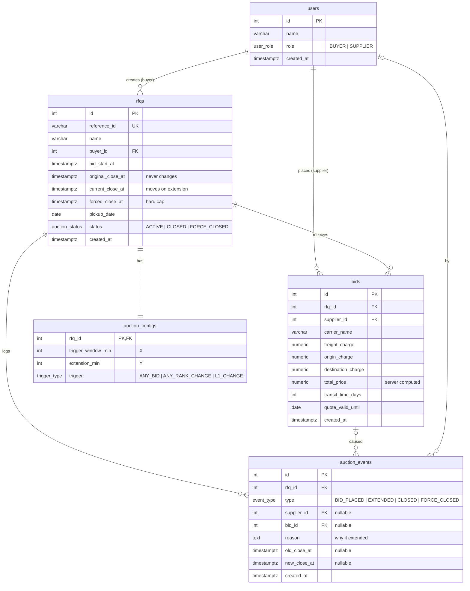

# Database Schema Design

PostgreSQL 16. The schema is created by the Alembic migration in `backend/alembic/versions/`,
and the SQLAlchemy models live in `backend/app/models/`.

## ER diagram



## Tables

### `users`
Buyers and suppliers. There is no password: the API identifies the caller with an `X-User-Id` header.

| Column | Type | Notes |
|---|---|---|
| id | `integer` PK | |
| name | `varchar(120)` | |
| role | `user_role` enum | `BUYER` or `SUPPLIER` |
| created_at | `timestamptz` | default `now()` |

### `rfqs`
One RFQ and its auction timing.

| Column | Type | Notes |
|---|---|---|
| id | `integer` PK | |
| reference_id | `varchar(64)` **UNIQUE** | business ID shown to users, e.g. `RFQ-2026-001` |
| name | `varchar(200)` | |
| buyer_id | `integer` FK → users | indexed |
| bid_start_at | `timestamptz` | bids are rejected before this |
| original_close_at | `timestamptz` | close time set by the buyer; **never changes** |
| current_close_at | `timestamptz` | starts equal to `original_close_at`, **moves forward** on each extension |
| forced_close_at | `timestamptz` | absolute limit; the auction can never run past it |
| pickup_date | `date` | pickup / service date |
| status | `auction_status` enum | `ACTIVE` (default), `CLOSED`, `FORCE_CLOSED` |
| created_at | `timestamptz` | |

CHECK constraints:
- `original_close_at > bid_start_at`
- `forced_close_at > original_close_at` (spec §7)
- `current_close_at BETWEEN original_close_at AND forced_close_at`: extensions can never pass the forced close (spec §5, §7)

### `auction_configs`
The British auction rules for one RFQ (1:1 with `rfqs`).

| Column | Type | Notes |
|---|---|---|
| rfq_id | `integer` PK, FK → rfqs (`ON DELETE CASCADE`) | |
| trigger_window_min | `integer`, CHECK `> 0` | **X**: the last X minutes before close are monitored |
| extension_min | `integer`, CHECK `> 0` | **Y**: minutes added when a trigger fires |
| trigger | `trigger_type` enum | `ANY_BID`, `ANY_RANK_CHANGE`, `L1_CHANGE` |

### `bids`
Every quote ever submitted. **Append-only**: a lower price is a new row, never an update.
A supplier's current quote is their latest row.

| Column | Type | Notes |
|---|---|---|
| id | `integer` PK | |
| rfq_id | `integer` FK → rfqs (`ON DELETE CASCADE`) | |
| supplier_id | `integer` FK → users | |
| carrier_name | `varchar(120)` | |
| freight_charge | `numeric(14,2)`, CHECK `>= 0` | |
| origin_charge | `numeric(14,2)`, CHECK `>= 0` | |
| destination_charge | `numeric(14,2)`, CHECK `>= 0` | |
| total_price | `numeric(14,2)` | computed by the server; CHECK `= freight + origin + destination` |
| transit_time_days | `integer`, CHECK `>= 0` | |
| quote_valid_until | `date` | validity of the quote |
| created_at | `timestamptz` | used for the tie-break: the earlier bid wins |

### `auction_events`
The activity log shown on the details page.

| Column | Type | Notes |
|---|---|---|
| id | `integer` PK | |
| rfq_id | `integer` FK → rfqs (`ON DELETE CASCADE`) | |
| type | `event_type` enum | `BID_PLACED`, `EXTENDED`, `CLOSED`, `FORCE_CLOSED` |
| supplier_id | `integer` FK → users, nullable | who caused it (null for closes) |
| bid_id | `integer` FK → bids, nullable (`ON DELETE SET NULL`) | the bid that caused it |
| reason | `text`, nullable | e.g. "L1 changed in the last 10 min" |
| old_close_at / new_close_at | `timestamptz`, nullable | filled for `EXTENDED`: "18:00 → 18:05" |
| created_at | `timestamptz` | |

## Indexes

| Index | Columns | Used by |
|---|---|---|
| `ix_bids_rfq_supplier_created` | `bids (rfq_id, supplier_id, created_at DESC)` | finding each supplier's latest bid (ranking) |
| `ix_bids_rfq_total_created` | `bids (rfq_id, total_price, created_at)` | listing bids sorted by price, then time |
| `ix_rfqs_active_current_close_at` | `rfqs (current_close_at) WHERE status = 'ACTIVE'` | Celery sweep for expired auctions. A **partial** index, so it only holds active RFQs. |
| `ix_auction_events_rfq_created` | `auction_events (rfq_id, created_at)` | activity log in time order |
| `ix_rfqs_buyer_id` | `rfqs (buyer_id)` | a buyer's RFQs |
| `uq_rfqs_reference_id` | `rfqs (reference_id)` UNIQUE | no duplicate reference IDs |

## Ranking query

Rank is **derived, never stored**: each supplier's latest bid, ordered by price, then by time.

```sql
SELECT * FROM (
    SELECT DISTINCT ON (supplier_id) *
    FROM bids
    WHERE rfq_id = :rfq_id
    ORDER BY supplier_id, created_at DESC, id DESC   -- latest bid per supplier
) latest
ORDER BY total_price ASC, created_at ASC;           -- L1 first; ties go to the earlier bid
```

## Design decisions

| Decision | Why | Alternative considered |
|---|---|---|
| Separate `original_close_at` and `current_close_at` | Shows "extended from 18:00 to 18:15" and keeps the original for reference | One `close_at` column (history lost) |
| Append-only `bids` | Full audit trail of every price offered; inserts never overwrite each other | One row per supplier, updated in place |
| Rank derived, not stored | Can never go stale or out of sync | `rank` column updated on every bid (faster reads, risk of stale data) |
| `total_price` stored | Can be indexed and sorted; set by the server, not the client | Computing the sum in every query |
| `NUMERIC(14,2)` for money | Exact decimal arithmetic | `float` (rounding errors), integer paise (also valid) |
| `timestamptz`, all UTC | No timezone ambiguity; the UI converts to IST | `timestamp` without zone |
| Native ENUM types | The DB rejects invalid statuses and roles | `varchar` + app-level checks only |
| CHECK constraints + API validation | Two independent layers enforce the rules | API validation only |
| `auction_configs` as its own table | Keeps auction rules apart from RFQ details | Extra columns on `rfqs` |
| `status` stores only terminal states; SCHEDULED is derived | Status before start follows from `bid_start_at`, so nothing has to flip it | Storing SCHEDULED and running a job to activate auctions |
